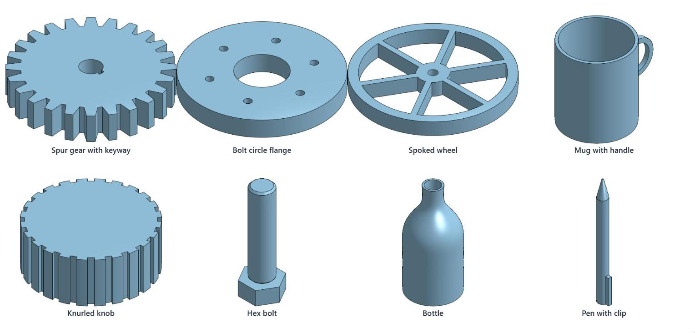

# CAD AI

Describe a part in plain English and get an Onshape custom feature that actually builds, with its sizes as editable parameters.



*All eight built in a real Onshape Part Studio, each as one clean solid. The flange was written by the AI from a prompt, the keyed gear came from the built-in gear builder, and the rest are features from the example library.*

🌐 [Live site](https://cad-ai-0o9s.onrender.com) · 📘 [Plain-language guide to the whole project](docs/GUIDE.md) · 📄 [FeatureScript submission packet (PDF)](CAD_AI_FeatureScript_Submission.pdf)

⚠️ Research prototype. Always check a generated part before you use it for anything real.

## Why I built it

Onshape lets you write your own CAD features in a language called FeatureScript. Once a feature exists, anyone can click it, type in a few sizes and get a finished part, and changing a number rebuilds the whole thing. Writing the feature is the hard part. FeatureScript is a niche language, and general AI models get it wrong in ways that are easy to miss: they call functions that don't exist, mix up inches and plain numbers, or write code that compiles fine and then builds the wrong shape. A flange comes back as a plain disc. A mug comes back sealed shut.

So the goal became a tool that checks its own work the way an engineer would before anyone sees the result. Every attempt gets test-built, inspected for the usual design mistakes and sent back to the AI with specific notes until it comes out right.

## What it does

Type something like *"a pipe flange, 120 mm across, with 6 bolt holes and a 40 mm bore"* and CAD AI:

- **Plans the part**: its components, sizes and how they attach.
- **Writes the FeatureScript**, with the main sizes exposed in the feature's dialog.
- **Test-builds it twice on your computer**, with no Onshape account needed: once in FS-Lite and once in a simulator that runs Onshape's own standard library on the OpenCascade CAD kernel.
- **Checks the design**: pieces that don't touch, cuts that remove nothing, containers sealed shut, pieces buried inside other pieces, and objects that came out as one plain block.
- **Fixes what's wrong** by sending the exact problem back to the AI, up to 6 rounds.
- **Never hands back a part that's known not to build.** If the AI can't get there, you get the closest real part from the dataset, clearly labeled, or a plain "try again".

The web app also has a **Debug** tab (paste code plus Onshape's error and get a fix), an **Images** tab (design from sketches or photos) and a **Guide** tab. Follow-up prompts like *"make it taller"* edit the current part instead of starting over.

## Data

- **DeepCAD part library**: real parts that people modeled in Onshape, with Text2CAD's text descriptions. The closest designs go to the AI as reference recipes, and they're also the backup library. Built by [scripts/deepcad_library/](scripts/deepcad_library/) into `data/deepcad_library_index.json.gz` and `data/deepcad_library_shapes.bin`. License: CC BY-NC-SA 4.0 (non-commercial).
- **BenchCAD standard parts**: 253 parts in 86 families converted from their CadQuery programs to FeatureScript and checked against CadQuery's own volumes (`data/benchcad_fs.json.gz`, built by [scripts/benchcad_fs/](scripts/benchcad_fs/)). A prompt that just names one ("a hex nut", "a pipe flange") gets it exactly, with no AI.
- **BenchCAD references**: named mechanical parts written as CadQuery code, for real proportions and features like fillets and revolves. Built by [scripts/dataset_refs/build_benchcad.py](scripts/dataset_refs/build_benchcad.py) into `data/benchcad_refs.json.gz`. License: CC-BY 4.0.
- **Omni-CAD** caption summaries and caption-geometry pairs ([data/](data/)).
- **Hand-checked FeatureScript features** in [data/fs_examples/](data/fs_examples/), from washers to spoked wheels. The closest match is shown to the AI as a working example.
- **Onshape's FeatureScript standard library** (MIT), which the simulator runs.

The raw downloads live in git-ignored folders (`.text2cad/`, `.datasets/`), and the scripts above turn them into the compact files in `data/` that the app reads. Nothing in the code depends on how many parts those files hold: rebuild them with more data and the site picks it up. The progress messages report the library size from the files themselves.

## Models

| Role | Model |
| --- | --- |
| Writes and fixes the code | Gemini 2.5 Flash (free key), with Groq's `gpt-oss-120b` and `qwen3.8-27b` as backups |
| Reads sizes and counts from the prompt | The same AI, with a rule-based reader ([promptDimensions.js](promptDimensions.js)) when no AI is available |
| Optional shape generator | Text2CAD, trained on DeepCAD, predicts sketch and extrude steps that [deepcadCompiler.js](deepcadCompiler.js) turns into FeatureScript |

Any OpenAI-compatible provider can be added in front of these (see Settings below).

## Results

How well the offline checks match real Onshape (a snapshot from November 2026; the test counts grow as examples are added):

| Check | Result |
| --- | --- |
| FS-Lite test build vs real Onshape, calibration parts | 17 / 17 agree |
| Both offline checks vs real Onshape, 6 AI-generated parts (Nov 2026) | 6 / 6 agree on builds, fails and number of pieces |
| Parts in the picture above, built in a real Onshape Part Studio | 8 / 8 build as one part |
| Simulator suite: every library example and generator output, each parameter at its min and max | 60 / 60 build |
| Known Onshape mistakes the simulator must reject | 20 / 20 rejected |

A spot check on the live site found these problems, and each one led to a fix or a new check in this version:

| Prompt | What Onshape showed | What changed |
| --- | --- | --- |
| Flange with bolt holes and a raised hub | A plain disc | Holes drawn in the outline sketch now stay open; a hub buried inside the plate is flagged |
| 6-spoke wheel | 9 loose pieces | Merges that named a cut instead of the cut part are repaired (9 pieces down to 2); loose pieces go back to the AI |
| L bracket with 4 holes | No holes | An auto-repair rule that broke the AI's correct unit math is fixed |
| Spur gear with a keyway | No keyway | The gear backup now cuts a keyway when the prompt asks for one |
| Coffee mug | Sealed shut, handle hidden inside | Sealed containers are flagged and sent back to the AI |
| Phone stand | Error, no part | Code that's known not to build is never returned |
| TV with an Ethernet cable | A plain slab: bezel and screen buried, port hole below the TV | Buried pieces are flagged, the AI is told the part kit takes the bottom height and not the center, and a hand-checked [TV example](data/fs_examples/tv_with_stand.fs) was added |

## Limitations

- The free AI tiers get busy. When they do, you get a backup part from the library instead of a new design (it says so), and complex requests may fail until you try again.
- Everyday objects like stands and enclosures still often come out simpler than you'd like. The checks catch parts that are broken, not parts that are boring.
- The design checks can't tell whether a part *looks* like what you asked for. A box that builds cleanly passes, even if you wanted a phone stand.
- The offline checkers don't cover every FeatureScript function (FS-Lite has to skip a few of the examples), so Onshape is still the final judge.
- Sketch, extrude and revolve work best. Lofts and sweeps are less reliable.
- The DeepCAD and Text2CAD data is non-commercial.

## Run it

Requirements: [Node.js 20+](https://nodejs.org/), [Python 3.10+](https://www.python.org/downloads/) and [git](https://git-scm.com/downloads).

```bash
npm install
```
```bash
npm run setup
```
```bash
npm start
```

`npm run setup` downloads the CAD kernel and Onshape's standard library (about 300 MB, once), creates your `.env` file and runs a self-test that should end with `both build checkers work on this computer`. It's safe to run again.

Then paste a free AI key into `.env`: a Gemini key from [aistudio.google.com/apikey](https://aistudio.google.com/apikey) goes after `ALT_LLM_API_KEY=`, or a Groq key from [console.groq.com/keys](https://console.groq.com/keys) after `GROQ_API_KEY=`. Open http://localhost:10000 and describe a part.

No key yet? The site still runs. It just answers with the closest part from the library, so you can try the whole flow first.

You can also run one prompt through the full pipeline from the terminal:

```bash
npm run test:e2e -- "Create a coffee mug with a handle, 80 mm across and 95 mm tall"
```

### Getting a part into Onshape

1. Click **Copy to Clipboard** on the site.
2. In your Onshape document, add a **Feature Studio** tab (the **+** at the bottom left).
3. Select everything in it (`Ctrl+A`) and paste.
4. Switch to a **Part Studio**. Your feature shows up at the right end of the toolbar.
5. Click it, change the sizes if you like, and click the green check mark. If you don't pick a plane it builds on Top.

Got a red error? Paste the code and the error into the **Debug** tab and click **Fix Code**.

### Prompts that work

Specific beats vague, every time.

| Instead of | Try |
| --- | --- |
| a bracket | an L bracket, 60 x 40 x 5 mm, with 4 countersunk mounting holes and a filleted inner corner |
| a gear | a spur gear with 24 teeth, module 2, 10 mm thick, with an 8 mm bore and a keyway |
| a wheel | a wheel 200 mm across with 6 spokes, a hub and a 12 mm axle hole |

Give sizes with units, count things ("6 bolt holes", not "some"), name the features you want (holes, fillets, a lip, a handle) and say how pieces attach ("the handle joins the side of the mug").

## More details

<details>
<summary><b>How a generation works, step by step</b></summary>

1. **Read the prompt.** Pull out the shape, sizes and counts.
2. **Find references.** The closest DeepCAD and BenchCAD parts, matching FeatureScript notes from the knowledge files in [data/](data/), and the closest hand-checked example. Markdown docs dropped into a `docs/fs_reference/` folder get searched too.
3. **Plan.** For named objects, list the real components, their sizes and how they attach.
4. **Write, test, fix.** A cleanup pass fixes common slips automatically (mixed units, `+` instead of `~` for text, holes that would get filled back in, merges that name the wrong piece). Then both test builds and the design check run, and anything wrong goes back to the AI as a specific note.
5. **Backups.** If nothing builds, the closest real dataset part or a hand-checked example, labeled as such, or a plain "please try again".

Most of this lives in [ai.js](ai.js). The cleanup rules are in [ai.js](ai.js), [featureScriptGeometry.js](featureScriptGeometry.js), [unitFixer.js](unitFixer.js) and [partKit.js](partKit.js); the design checks are in [scripts/local_build.py](scripts/local_build.py).
</details>

<details>
<summary><b>Test-building without Onshape</b></summary>

**The simulator** ([fs_sim/](fs_sim/README.md)) runs Onshape's own standard library on OpenCascade, so errors come out in Onshape's words. It can save a picture of the part:

```bash
npm run sim:run -- data/fs_examples/wheel_with_spokes.fs --png wheel.png
```

**FS-Lite** (from [onshape-fsgen](https://github.com/Lucasfrit/onshape-fsgen), MIT) is faster and also reports size, volume and design notes. On Windows:

```bash
.fsgen/venv/Scripts/python scripts/local_build.py --png out data/fs_examples/flat_washer.fs
```

On macOS or Linux use `.fsgen/venv/bin/python`. `LOCAL_BUILD_CHECK=0` in `.env` turns FS-Lite off.

**Real Onshape checks** are optional: add API keys from [dev.onshape.com/keys](https://dev.onshape.com/keys) and a test document to `.env` (`ONSHAPE_ACCESS_KEY`, `ONSHAPE_SECRET_KEY`, `ONSHAPE_TEST_DOCUMENT_ID`, `ONSHAPE_TEST_WORKSPACE_ID`, `ONSHAPE_TEST_PARTSTUDIO_ID`). Onshape limits API calls per year, so this only runs on parts that already passed both local builds.
</details>

<details>
<summary><b>Tests</b></summary>

None of these need an AI key.

| Command | What it checks |
| --- | --- |
| `npm test` | Everything below except the simulator |
| `npm run test:validator` | Hand-checked examples pass the cleanup pass untouched; known-bad code is caught or repaired |
| `npm run test:units` | The automatic unit fixes |
| `npm run test:plan` | The plan compiler |
| `npm run test:fallback` | With no AI, the right example is picked and your sizes land in it |
| `npm run test:deepcad` | DeepCAD, Text2CAD and `cad-sequence/v1` files compile; bad ones are rejected |
| `npm run test:deepcad-e2e` | The website's DeepCAD calls against a stand-in model service |
| `npm run test:sim` | Every example and generator output builds in the simulator at each parameter's min and max, and 20 known mistakes are rejected (needs `npm run setup`) |

These need something extra: `npm run test:e2e -- "prompt"` (an AI key), `npm run test:deepcad-live` (the Text2CAD model running via `npm run deepcad:serve`) and `npm run model:check` (the CADFS-2B model via `npm run model:serve`).
</details>

<details>
<summary><b>Running it in the cloud</b></summary>

The app runs anywhere Node 22 runs and boots without keys.

- **Render**: *New*, then *Blueprint*, then this repo. [render.yaml](render.yaml) asks for the secret keys. The free plan is too small for the simulator, so the public site sends build checks to a small Modal service: `npm run sim:modal-secret`, then `npm run sim:deploy`, then set `FS_SIM_URL` and `FS_SIM_TOKEN` in Render. `/health` shows `"simulator": true` when it works. Redeploy the Modal service after changing `scripts/local_build.py` or `fs_sim/`.
- **Docker** (Railway, Fly.io, Cloud Run, a VPS), simulator included:
  ```bash
  docker build -t cad-ai .
  ```
  ```bash
  docker run -p 10000:10000 --env-file .env cad-ai
  ```
- **CI**: [.github/workflows/ci.yml](.github/workflows/ci.yml) runs the tests on every push and checks that `/generate` works with no keys.

The public site allows 12 AI requests per visitor per 10 minutes (`RATE_LIMIT_MAX`, `RATE_LIMIT_WINDOW_MS`).
</details>

<details>
<summary><b>The DeepCAD generator (optional)</b></summary>

Pick **DeepCAD model** in the Generator menu to get shapes from Text2CAD instead of an LLM. No model-written text ends up in the code, so it can't have syntax errors, but it only makes sketch and extrude parts.

To set it up, accept the terms at [huggingface.co/datasets/SadilKhan/Text2CAD](https://huggingface.co/datasets/SadilKhan/Text2CAD), make a read token (`HF_TOKEN`), and either run it locally (`npm run deepcad:serve`, see [hf_space/README.md](hf_space/README.md)) or on Modal (`npm run deepcad:modal-secret`, then `npm run deepcad:deploy`). Then set `DEEPCAD_MODEL_URL` (and `DEEPCAD_MODEL_TOKEN`).

| Endpoint | Send | Get back |
| --- | --- | --- |
| `POST /generate` | `{ prompt }`, plus `history` to edit a part | FeatureScript and how it was made |
| `POST /generate-deepcad` | `{ prompt }` or `{ sequence }` | FeatureScript from the model or your sequence |
| `POST /verify` | `{ code }` | Static check, both test builds and a picture |
| `GET /health` | | Which models, keys and checkers are active |
</details>

<details>
<summary><b>Settings</b></summary>

Everything lives in `.env`, which `npm run setup` creates and git never commits.

| Setting | What it does |
| --- | --- |
| `ALT_LLM_API_KEY`, `ALT_LLM_BASE_URL`, `ALT_LLM_MODEL` | Any OpenAI-compatible provider, tried first. Add `_2`, `_3` and so on for more. |
| `GROQ_API_KEY` (and `GROQ_API_KEY2`, ...) | Groq keys, used as the backup |
| `PORT` | Where the site runs (default 10000) |
| `SUPABASE_URL`, `SUPABASE_ANON_KEY` | Optional accounts and history |
| `CAD_CANDIDATE_COUNT`, `CAD_REPAIR_ATTEMPTS` | How many attempts and repair passes |
| `LOCAL_BUILD_CHECK=0` | Turns off the FS-Lite test build |
| `FS_SIM_PYTHON` | Which Python runs the simulator (default: the one setup made) |

| Free provider | Key | `ALT_LLM_BASE_URL` | `ALT_LLM_MODEL` |
| --- | --- | --- | --- |
| Google Gemini | [aistudio.google.com/apikey](https://aistudio.google.com/apikey) | `https://generativelanguage.googleapis.com/v1beta/openai` | `gemini-3.8-flash` |
| Cerebras | [cloud.cerebras.ai](https://cloud.cerebras.ai) | `https://api.cerebras.ai/v1` | `gpt-oss-120b` |

A provider that's rate-limited or down is skipped for a minute, then tried again.
</details>

<details>
<summary><b>Teaching it new parts</b></summary>

Good examples are the best way to improve results:

1. Write a complete feature in `data/fs_examples/<name>.fs`: one exported `defineFeature`, with the main sizes as dialog parameters.
2. Add it to [data/fs_examples/manifest.json](data/fs_examples/manifest.json) with the words someone would type to ask for it.
3. Check it:
   ```bash
   npm run test:validator
   ```
   ```bash
   npm run test:sim
   ```

FeatureScript gotchas the AI is taught:

- Patterns use `opPattern` with an array of transforms. `opPatternCircular` and `opPatternLinear` don't exist.
- Text joins with `~`, not `+`. Arrays grow with `append()` and use `size()`, not `.length`.
- `isLength` parameters already carry units, so don't multiply them by `inch` again.
- Holes drawn in the outline's sketch need `qSketchRegion(id + "sketch", true)` or the extrude fills them in.
- `opShell` given a whole body makes a sealed hollow. For a cup, give it the top face to remove.
- A raised hub has to start on the face it stands on, or it's buried and invisible.
- Everyday objects are several pieces: a pen is a barrel, a tip and a clip, not one long cylinder.
</details>

<details>
<summary><b>Troubleshooting</b></summary>

- **Setup's self-test didn't pass.** Check that `python --version` shows 3.10 or newer, then run `npm run setup` again; it picks up where it stopped.
- **`npm run test:sim` says `No module named 'OCP'`.** It found a Python without the CAD kernel. Run `npm run setup`, or set `FS_SIM_PYTHON`.
- **"The AI could not make a part that builds this time".** The free AI tiers are busy. Wait a minute, or add a second provider in `.env`.
- **The feature is red in Onshape.** Paste the code and the error into the **Debug** tab.
- **It builds but looks wrong.** Be more specific about sizes and how the pieces connect, or describe the change as an edit.
</details>

<details>
<summary><b>Project layout</b></summary>

| Path | What's there |
| --- | --- |
| [server.js](server.js) | Web server and API (`npm start`) |
| [ai.js](ai.js) | The generation pipeline |
| [featureScriptGeometry.js](featureScriptGeometry.js), [unitFixer.js](unitFixer.js) | Automatic geometry and unit fixes |
| [partKit.js](partKit.js) | Helpers (`kitBox`, `kitCut`, `kitMerge`, ...) the AI builds parts from |
| [localBuild.js](localBuild.js), [scripts/local_build.py](scripts/local_build.py) | FS-Lite test build and design checks |
| [simulatorClient.js](simulatorClient.js), [fs_sim/](fs_sim/) | The FeatureScript simulator |
| [onshapeClient.js](onshapeClient.js) | Optional checks in a real Onshape document |
| [learning.js](learning.js), [adaptiveNetwork.js](adaptiveNetwork.js) | Reference lookup and the small reranker |
| [datasetReferences.js](datasetReferences.js), [deepcadLibrary.js](deepcadLibrary.js) | Real parts from DeepCAD and BenchCAD |
| [deepcadCompiler.js](deepcadCompiler.js), [deepcadService.js](deepcadService.js), [hf_space/](hf_space/) | The DeepCAD / Text2CAD generator |
| [data/](data/) | Knowledge rows, dataset summaries, part libraries, examples |
| [docs/](docs/) | Research notes for the AI and pictures for this page |
| [public/](public/) | The web page |
| [scripts/](scripts/) | Setup, tests and data tools |
| [supabase/](supabase/) | Database migrations |
</details>

<details>
<summary><b>Rebuilding the submission PDF</b></summary>

[CAD_AI_FeatureScript_Submission.pdf](CAD_AI_FeatureScript_Submission.pdf) has the feature catalog, install steps, validation results and full source. After changing the library, install `reportlab` once and rebuild it (Windows paths; use `.fsgen/venv/bin/python` elsewhere):

```bash
.fsgen/venv/Scripts/python -m pip install reportlab
```
```bash
.fsgen/venv/Scripts/python scripts/build_submission_pdf.py --author "Your Name"
```
</details>

## Future work

- Count what the built part actually has (holes, teeth, spokes) and compare it with the prompt.
- Run every part through real Onshape automatically when API quota allows.
- More hand-checked examples for everyday objects, where results are weakest today.
- Multi-part designs that come out as an assembly instead of a single part.

## License

MIT. See [LICENSE](LICENSE). That covers the project's own code and the example features; use them however you like.

Third-party material keeps its own license: files built from the DeepCAD and Text2CAD data are CC BY-NC-SA 4.0 (non-commercial), BenchCAD-derived files are CC BY 4.0, and Onshape's standard library and onshape-fsgen (both downloaded by `npm run setup`) are MIT. The details are at the bottom of [LICENSE](LICENSE).
