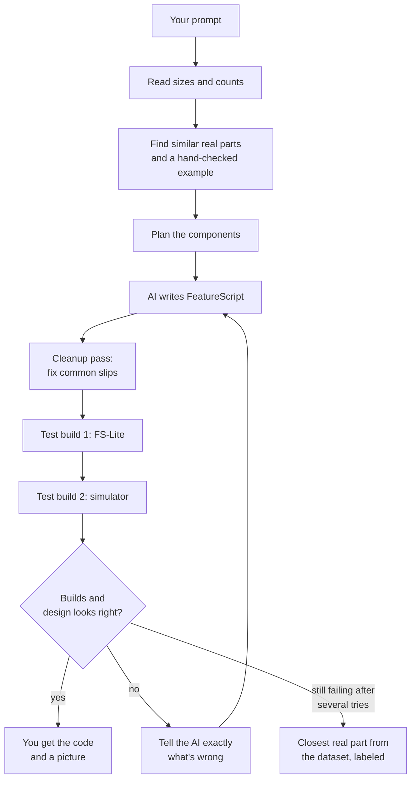
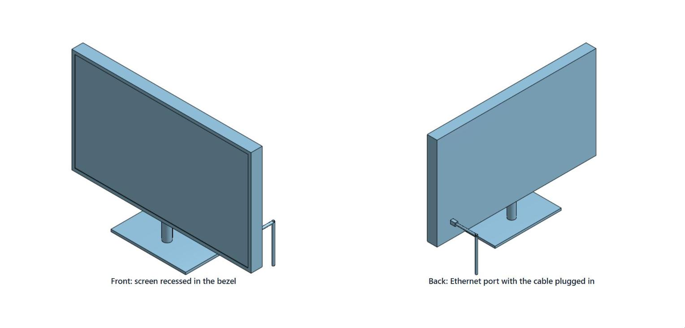

# The CAD AI guide

This is the plain-language tour of the whole project: what every piece does, how they fit together, how to run and change it, how to publish your features on Onshape, and how to talk about it. You don't need to read it in order. Jump to whatever you need.

**Contents**

1. [The big idea in one minute](#1-the-big-idea-in-one-minute)
2. [Words you'll see](#2-words-youll-see)
3. [What happens when you click Generate](#3-what-happens-when-you-click-generate)
4. [A real example: the TV](#4-a-real-example-the-tv)
5. [Every file, and what it does](#5-every-file-and-what-it-does)
6. [Running it](#6-running-it)
7. [How to know nothing is broken](#7-how-to-know-nothing-is-broken)
8. [Updating the datasets](#8-updating-the-datasets)
9. [Putting it online](#9-putting-it-online)
10. [Publishing your features on Onshape](#10-publishing-your-features-on-onshape)
11. [Talking about this project](#11-talking-about-this-project)
12. [Questions that come up](#12-questions-that-come-up)

---

## 1. The big idea in one minute

**Onshape** is a CAD program that runs in the browser. Normally you build a part by clicking: draw a sketch, extrude it, cut a hole.

**FeatureScript** is Onshape's programming language. With it you can write your *own* tool, called a **custom feature**. A custom feature shows up as a button in Onshape. Click it, type in a few sizes, and it builds the whole part for you. Change "6 bolt holes" to "8" and the part rebuilds.

**CAD AI writes those custom features for you** from a sentence like *"a pipe flange with 6 bolt holes"*.

The catch: AI models are bad at FeatureScript. It's a small language they've seen very little of, so they make mistakes that are easy to miss. The code can look perfect and still fail in Onshape, or build without errors into the wrong shape.

So most of this project is **checking the AI's work**:

- it **test-builds** every attempt on your own computer, without Onshape,
- it **inspects the result** for design mistakes (pieces that don't touch, holes that cut nothing, pieces buried inside other pieces),
- it **tells the AI exactly what's wrong** and makes it try again.

Think of it as an AI drafter with a strict engineer checking every drawing before it leaves the office.

---

## 2. Words you'll see

| Word | What it means here |
| --- | --- |
| **Part Studio** | The Onshape tab where parts get built. |
| **Feature Studio** | The Onshape tab where FeatureScript code lives. You paste CAD AI's output here. |
| **Custom feature** | A tool you wrote in FeatureScript. Shows up in the Part Studio toolbar. |
| **Dialog / parameters** | The box that pops up when you click a feature, with sizes you can change. In code, this is the `precondition` block. |
| **Sketch** | A flat 2D drawing (lines, circles, rectangles) on a plane. |
| **Extrude** | Pull a sketch straight up into a 3D solid. |
| **Revolve** | Spin a sketch around an axis (how you make a bottle or a vase). |
| **Boolean** | Combining solids. **Union** joins them into one, **subtraction** cuts one out of another (that's how holes are made). |
| **Body / part** | One solid object. A good result is usually exactly one. |
| **Prompt** | What you type to describe the part. |
| **LLM** | Large language model, the AI that writes the code (Gemini or a Groq model here). |
| **Test build** | Running the FeatureScript to see if it really makes a part. |
| **FS-Lite** | A fast FeatureScript interpreter (someone else's open-source project) used for one of the test builds. |
| **The simulator (fs_sim)** | The other test build. It runs Onshape's *own* standard library code on a free CAD engine, so its errors match Onshape's. |
| **OpenCascade** | The free 3D geometry engine both test builds use, instead of Onshape's. |
| **Part kit** | Helper functions (`kitBox`, `kitCylinder`, `kitRod`, `kitCut`, `kitMerge`) the AI can use, so it can place blocks at x, y, z instead of hand-drawing every sketch. |
| **Cleanup pass** (the "sanitizer") | Automatic fixes for common AI slips before anything is tested. |
| **Design check** | Looking at the built part for problems that aren't errors: loose pieces, cuts that remove nothing, buried pieces, sealed containers. |
| **Fallback** | The plan B when the AI can't get it right: a real part from the dataset or a hand-checked example. |
| **Dataset** | Collections of real CAD parts that people made (DeepCAD, BenchCAD). Used as examples for the AI and as fallbacks. |

---

## 3. What happens when you click Generate



Step by step, in plain words:

1. **Read the prompt.** Pull out the shape, the sizes and the counts ("6 holes", "80 mm"). If no AI is available, a rule-based reader does it ([promptDimensions.js](../promptDimensions.js)).
2. **Find references.** Search the dataset for similar real parts, and pick the closest hand-checked example from [data/fs_examples/](../data/fs_examples/). Both go into the AI's instructions, so it copies good habits instead of inventing from scratch.
3. **Plan.** For named things (a mug, a TV), the AI first lists the components: body, handle, stand. It writes down their sizes and how they attach.
4. **Write.** The AI writes the FeatureScript.
5. **Clean up.** The cleanup pass fixes slips it knows about. Some examples:
   - `+` instead of `~` for joining text
   - mixed-up units (inches times inches)
   - holes that would get filled back in
   - merges that point at the wrong piece
6. **Test-build twice.** FS-Lite, then the simulator. If either finds an error, the error message goes back to the AI.
7. **Design check.** Even if it builds, is it *right*? The checker looks for:
   - pieces that never touched, so the part is several loose solids,
   - a cut that removed nothing, so the hole is missing,
   - a piece completely buried inside another one, so it's invisible,
   - a container sealed shut,
   - a "phone stand" that's just one plain box.
8. **Fix loop.** Anything found goes back to the AI as a specific note. It gets up to 6 tries.
9. **Fallback.** If nothing works, you get the closest real part from the dataset (clearly labeled), or a plain "try again". **A part that's known to be broken is never handed to you as if it were fine.**

The code for all of this lives in [ai.js](../ai.js). The function that runs the loop is `runGenerateTestFixLoop`, and the one that drives a whole request is `generateFeatureScript`.

---

## 4. A real example: the TV

This really happened, and it's a great way to see the system work.

**The prompt:** a TV with an Ethernet cable.

**What the AI wrote:** a TV body, a bezel, a screen, a stand and an Ethernet hole, all made with the part kit. It built without errors. But in Onshape it looked like **a plain flat slab**.

**Why:** the part kit's `kitBox` takes the **bottom** height of a piece. The AI gave it each piece's **center** height instead. So:

- the bezel and the glass ended up *inside* the TV body, which hid them,
- the Ethernet hole ended up *below* the TV, so it cut nothing,
- and the AI also laid the whole TV on its back, with the stand pointing down.

**What the checks now say about that code:**

> opBoolean "cutEthernet" (SUBTRACTION) removed no material...
> the piece made by "bezel" lies completely inside "chassis", so it adds nothing and cannot be seen...
> the piece made by "glass" lies completely inside "chassis"...
> In kitBox and kitCylinder the 6th argument is the BOTTOM z, not the center...

Those notes go straight back to the AI. The part kit's instructions also now say plainly that `bottomZ` is the bottom, and that upright objects stand along z.

**The fixed version** is now a hand-checked example, [data/fs_examples/tv_with_stand.fs](../data/fs_examples/tv_with_stand.fs). It stands upright on a stand, has a recessed screen inside a bezel, an RJ45 port on the back and an optional cable. Every size is in the dialog. It builds in real Onshape as one part, with exactly the same volume the offline checkers predicted. Future TV or monitor prompts get it as their working example.



**The lesson:** "it builds" is not the same as "it's right". That's why the design check exists.

---

## 5. Every file, and what it does

### The web app

| File | What it does | Look here when you want to... |
| --- | --- | --- |
| [server.js](../server.js) | The web server. Defines the API: `/generate`, `/verify`, `/health` and more. | add an API endpoint, change rate limits |
| [public/index.html](../public/index.html), [public/script.js](../public/script.js), [public/index.css](../public/index.css) | The web page you see. | change the look, the buttons or the text |
| [Auth.js](../Auth.js) | Optional sign-in and history (needs Supabase). | change accounts |

### The brain

| File | What it does | Look here when you want to... |
| --- | --- | --- |
| [ai.js](../ai.js) | The whole generation pipeline: prompts to the AI, the fix loop, the cleanup rules, the fallbacks. It's big; search for the function names in section 3. | change how the AI is asked, or what happens on failure |
| [partKit.js](../partKit.js) | The part kit helpers, and what the AI is told about them. Also repairs merges that name the wrong piece. | add a new helper like `kitSphere` |
| [featureScriptGeometry.js](../featureScriptGeometry.js) | Cleanup rules for geometry: holes that would get filled, unit mistakes inside points, revolve axes. | fix a new kind of AI geometry mistake |
| [unitFixer.js](../unitFixer.js) | Cleanup rules for mixed units ("2 + 3 inches"). | fix a unit mistake |
| [promptDimensions.js](../promptDimensions.js) | Reads sizes and counts from a prompt without AI. | improve the no-AI fallback |
| [planCompiler.js](../planCompiler.js) | Turns a structured plan into FeatureScript directly. | work on the plan-based path |
| [learning.js](../learning.js), [adaptiveNetwork.js](../adaptiveNetwork.js) | Finds relevant reference rows and docs; a tiny neural network re-ranks them. | change what context the AI sees |

### The checkers

| File | What it does |
| --- | --- |
| [localBuild.js](../localBuild.js) + [scripts/local_build.py](../scripts/local_build.py) | Test build 1 (FS-Lite) and the **design checks** (loose pieces, empty cuts, buried pieces, sealed shells). |
| [simulatorClient.js](../simulatorClient.js) + [fs_sim/](../fs_sim/) | Test build 2, the simulator that runs Onshape's own library. |
| [onshapeClient.js](../onshapeClient.js) | Optional: check code in a real Onshape document with API keys. |
| [checkerService.js](../checkerService.js) | Finds the remote checker service when the site runs in the cloud. |

### The knowledge

| Path | What's there |
| --- | --- |
| [data/fs_examples/](../data/fs_examples/) | Hand-checked example features, plus [manifest.json](../data/fs_examples/manifest.json), which lists the words that make each example get picked. |
| `data/deepcad_library_index.json.gz`, `data/deepcad_library_shapes.bin` | The DeepCAD part library: real parts, used as references and fallbacks. |
| `data/benchcad_refs.json.gz` | BenchCAD references: named mechanical parts with real proportions. |
| [datasetReferences.js](../datasetReferences.js), [deepcadLibrary.js](../deepcadLibrary.js) | The code that searches those libraries. |
| [deepcadCompiler.js](../deepcadCompiler.js), [deepcadService.js](../deepcadService.js) | Turn DeepCAD-style sketch/extrude steps into FeatureScript. |
| other files in [data/](../data/) | Knowledge rows, dataset summaries, the failure corpus. |

### Scripts and tests

| Path | What's there |
| --- | --- |
| [scripts/setup_local.mjs](../scripts/setup_local.mjs) | What `npm run setup` runs. |
| [scripts/validator_regression.mjs](../scripts/validator_regression.mjs) and the other `*_check.mjs` files | The tests (section 7). |
| [scripts/deepcad_library/](../scripts/deepcad_library/), [scripts/dataset_refs/](../scripts/dataset_refs/) | Download and build the datasets (section 8). |
| [scripts/build_submission_pdf.py](../scripts/build_submission_pdf.py) | Builds the feature catalog PDF. |
| [hf_space/](../hf_space/), [model_service/](../model_service/) | Optional AI model services (Text2CAD, CADFS-2B). |

---

## 6. Running it

You need Node.js 20 or newer, Python 3.10 or newer, and git.

```bash
npm install
```
Downloads the Node packages the server needs.

```bash
npm run setup
```
One time. It does four things:
- installs the CAD engine into `.fsgen/`,
- downloads FS-Lite,
- downloads Onshape's standard library into `fs_sim/std/`,
- creates `.env`.

Then it runs a self-test. Look for `both build checkers work on this computer`.

Then open `.env` and paste a free AI key after `ALT_LLM_API_KEY=` (Gemini, from aistudio.google.com/apikey) or after `GROQ_API_KEY=` (Groq).

```bash
npm start
```
Starts the site at http://localhost:10000.

```bash
npm run test:e2e -- "a phone stand with a lip"
```
Runs one prompt through the whole pipeline in the terminal and prints what happened. Great for debugging.

To check any FeatureScript file and get a picture of the part:

```bash
npm run sim:run -- data/fs_examples/tv_with_stand.fs --png tv.png
```

---

## 7. How to know nothing is broken

Run this after every change:

```bash
npm test
```

It runs six quick test suites, and none of them need an AI key:

| Suite | What it proves |
| --- | --- |
| units | The automatic unit fixes still work |
| validator | The hand-checked examples pass the cleanup pass **untouched**, and known-bad code still gets caught or fixed |
| plan | The plan compiler still makes valid code |
| fallback | With no AI, prompts still get a sensible example with their sizes |
| deepcad | DeepCAD files still compile |
| deepcad-e2e | The website's DeepCAD calls still work |

And the deep one (takes a few minutes):

```bash
npm run test:sim
```

It builds every example and every generator output in the simulator, with **each dialog setting at its minimum and its maximum**. It also checks that 20 known Onshape mistakes are rejected. If someone sets "Width" to its smallest value and the part breaks, this is where you find out.

**Adding a new example?** It has to pass both: the validator (it must come through the cleanup pass with zero changes) and the simulator sweep.

---

## 8. Updating the datasets

Raw downloads are big, so they never go into git. They live in git-ignored folders, and scripts turn them into the small files in `data/` that the app reads.

| Dataset | Raw download goes in | Built by | App reads |
| --- | --- | --- | --- |
| DeepCAD / Text2CAD | `.text2cad/data/` | [download.py](../scripts/deepcad_library/download.py), [extract.py](../scripts/deepcad_library/extract.py), then [build.mjs](../scripts/deepcad_library/build.mjs) (`compile`, then `select`) | `data/deepcad_library_index.json.gz` + `data/deepcad_library_shapes.bin` |
| BenchCAD | `.datasets/BenchCAD/` | [build_benchcad.py](../scripts/dataset_refs/build_benchcad.py) | `data/benchcad_refs.json.gz` |

Things to know:

- **Nothing in the code depends on how many parts there are.** Rebuild the files with more data and the app just uses it. The progress messages read the size from the files.
- DeepCAD needs a Hugging Face token (`HF_TOKEN` in `.env`) from an account that accepted the Text2CAD terms.
- A **brand-new dataset** in a different format needs a small loader, written the way [datasetReferences.js](../datasetReferences.js) loads BenchCAD. Then add it to the table above.
- Check licenses before you publish data. DeepCAD is non-commercial (CC BY-NC-SA 4.0); BenchCAD is CC BY 4.0.

---

## 9. Putting it online

The public site runs on **Render** (free plan) and talks to a small **Modal** service for the test builds, because the free Render plan doesn't have enough memory for them.

- **Render** redeploys by itself whenever you push to GitHub. Settings live in Render's Environment tab: AI keys, `FS_SIM_URL`, `FS_SIM_TOKEN`.
- **Modal** does *not* redeploy by itself. After changing `scripts/local_build.py` or anything in `fs_sim/`, run `npm run sim:deploy`, or the site keeps the old checker.
- `https://<your-site>/health` shows what's working: which AI providers, whether the simulator is connected, and whether the dataset library is there.

Docker works too (see the README). It bundles everything into one container.

---

## 10. Publishing your features on Onshape

Any feature CAD AI made, or any file in [data/fs_examples/](../data/fs_examples/), can become a real Onshape tool other people can use.

**To use it yourself:**

1. In an Onshape document, click **+** (bottom left), then **Create Feature Studio**.
2. Select all, paste the code, and wait for it to compile. Errors show in red.
3. In a Part Studio, the feature appears at the right end of the toolbar.

**To share it with everyone:**

1. Put your Feature Studios in one document, named clearly (say, "CAD AI feature library"), with one Feature Studio per feature.
2. **Make a version**: the clock icon (Versions and history), then **Create version**. Others can only add features from a version, never from a work in progress.
3. **Make it public** (Share, then Public), or share the link. On a free Onshape plan, documents are public anyway.
4. Anyone can now add your features: in their Part Studio, the **Custom features** button (at the right end of the toolbar), then **Add custom features**, then search for your document or paste its link.
5. When you improve a feature, make a new version. People get an "update available" prompt.

**Good habits for a public library:**

- Clear names (`TV With Stand And Ethernet Port`, not `feature1`) and labels in the dialog.
- Sensible min and max for every size. The simulator test (`npm run test:sim`) proves each feature survives its own min and max, so run it before you publish.
- A short comment at the top of each feature saying what it builds.
- [CAD_AI_FeatureScript_Submission.pdf](../CAD_AI_FeatureScript_Submission.pdf) is a ready-made catalog of the library, with install steps and the full source. Rebuild it after adding features (README, "Rebuilding the submission PDF").

---

## 11. Talking about this project

For college or job applications, here's what's genuinely strong about it, in order:

1. **It checks AI output instead of trusting it.** Plenty of people wrap an AI model; few build the testing that tells you when it's wrong. This project runs the AI's code through two independent test builds and a design check, and it measured how often those checks agree with the real thing.
2. **It has real numbers.** For example:
   - the offline checks agreed with real Onshape on 17 of 17 calibration parts,
   - they agreed on 6 of 6 AI-generated parts in a spot check,
   - every example survives its dialog's extreme values in an automated test.

   Numbers beat adjectives.
3. **It learned from its failures.** The TV story in section 4 is a perfect interview answer to "tell me about a bug you fixed". You saw a part that looked wrong, traced it to a single misunderstanding (center vs. bottom), added a check that catches the whole class of mistake, and fed it back to the AI.

**One sentence:**

> I built a tool that turns plain-English descriptions into working Onshape CAD features, plus a testing system that checks the AI's output the way an engineer would before anyone sees it.

**For a resume** (adjust to what *you* built, and keep the numbers current):

- Built a text-to-CAD pipeline that generates parametric Onshape FeatureScript with an LLM, then test-builds and design-checks every attempt before returning it.
- Built offline FeatureScript test builds (Onshape's standard library on OpenCascade) that matched real Onshape on 17 of 17 calibration parts.
- Added automated design checks (disconnected pieces, empty cuts, buried geometry, sealed containers) whose findings feed back into the AI's next attempt.

**Show, don't tell:**

- the picture at the top of the README,
- a short screen recording of typing a prompt and the part appearing in Onshape,
- the live site link,
- the "Results" table in the README.

Be ready to explain the limits honestly (the README's Limitations section). Saying "it catches broken parts, but not boring ones yet, and here's what I'd try next" sounds like an engineer.

---

## 12. Questions that come up

**The site says the AI is busy or unavailable.** The free AI tiers have per-minute limits. Wait a minute, or add a second provider in `.env` (the README's Settings section shows how).

**A part builds but looks wrong.** Read the "Check this part" warning if there is one. Then be more specific: give sizes, counts, and how the pieces attach. Or describe the fix as an edit ("move the handle so it touches the side").

**Onshape shows a red error.** Paste the code and the error into the site's **Debug** tab.

**Why do the files say `FeatureScript 2931` when Onshape is newer?** Every FeatureScript file says which version of Onshape's library it was written for. Onshape keeps old versions working, so 2931 is fine. You can update the number later.

**Why both FS-Lite *and* the simulator?** They fail in different ways. FS-Lite is fast and reports the part's size, volume and design notes, but it doesn't know every Onshape function. The simulator runs Onshape's real library, so it knows them all, but it's slower. Together they catch more than either one alone.

**Where do I change what the AI is told?** In [ai.js](../ai.js): search for `buildSystemPromptForRequest` (the main instructions) and `buildChatbotCandidatePrompt` (the per-request part). The part kit's instructions are `PART_KIT_PROMPT` in [partKit.js](../partKit.js).

**How do I add a new automatic fix?** Add a rule in [featureScriptGeometry.js](../featureScriptGeometry.js) (geometry) or [unitFixer.js](../unitFixer.js) (units). Then add a test case to [scripts/validator_regression.mjs](../scripts/validator_regression.mjs) and run `npm test`.

**How do I add a new design check?** Look at `op_boolean` and `op_shell` in [scripts/local_build.py](../scripts/local_build.py). They measure the part before and after each operation and add a note when something's off. The notes reach the AI through `designIssueFeedback` in [ai.js](../ai.js). Remember to run `npm run sim:deploy` afterwards for the public site.
